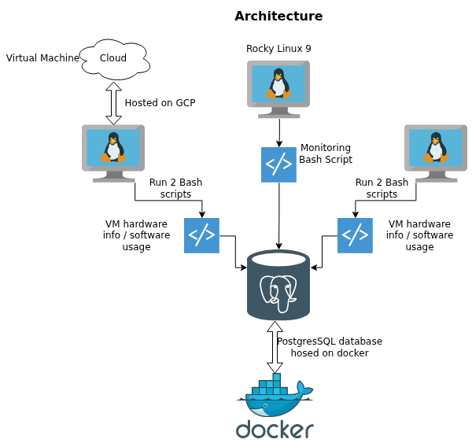

# Linux Cluster Monitoring Agent

## Introduction

This project is a ligntweight Linux cluster monitoring agent build to collect and store both hardware information and resource usage every minutes from linux host. The goal is to provide a simple and reliable way to track system health over time using standard Linux tools and a PostgreSQL database.

A small set of Bash scripts runs on every node: one script records the machine's hardware specifications a single time, and another samples its resource usage (free memory, CPU idle and kernel time, disk I/O and free disk space) every minute. All of the data is stored in a PostgreSQL database that runs inside a Docker container.

This agent is bulit using open-source tools like Bash, Docker, Git, and PostgreSQL.

---

## Quick Start
```bash 
# 1. Start PostgreSQL using Docker (psql_docker.sh)
bash scripts/psql_docker.sh start postgres password

# 2. Create database tables using ddl.sql
psql -h localhost -U postgres -d host_agent -f sql/ddl.sql

# 3. Insert hardware specs data into the DB using host_info.sh
bash scripts/host_info.sh localhost 5432 host_agent postgres password

# 4. Insert hardware usage data into the DB using host_usage.sh
bash scripts/host_usage.sh localhost 5432 host_agent postgres password

# 5. Crontab setup
corntab -e
Example : * * * * * bash /full_path.../host_usage.sh localhost 5432 host_agent postgres password >> /tmp/hostusage.log 2>&1
```
---

## Implementation

### Architecture



This project has simple agent-based architecture. Each linux VM runs two bash scripts that act as a monitoring agents. these agents collects data locally and stored it in PostgresSQL Database. Here, Database runs inside a Docker container.

---

### Scripts

#### psql_docker.sh
Manages the lifecycle of a PostgreSQL Docker container(start,stop,create) and ensures the database service is available before agents run.

```bash
bash scripts/psql_docker.sh start postgres password
```

---

#### host_info.sh
Collects static hardware details such as CPU count, architecture, CPU model, total memory, and cache size. This script is intended to be executed once per host.

```bash
bash scripts/host_info.sh psql_host psql_port db_name psql_user psql_password
```
---

#### host_usage.sh
Collects runtime system metrics including free memory, CPU usage, disk I/O, and available disk space. This script is designed to be executed every minutes using corntab.

```bash
bash scripts/host_usage.sh psql_host psql_port db_name psql_user psql_password
```

---

#### crontab
Used to schedule periodic execution(every minutes) with the help of host_usage.sh script for continuous monitoring.

---

#### queries.sql
Contains SQL queries that help analyze collected data, such as average memory usage, CPU utilization trends, and disk availability across hosts.

---

### Database Modeling

### host_info

| Column Name | Description |
|------------|-------------|
| id | Unique id for each host |
| hostname | Fully qualified domain name |
| cpu_number | Number of CPU |
| cpu_architecture | CPU architecture |
| cpu_model | CPU model name |
| cpu_mhz | CPU clock speed |
| l2_cache | L2 cache size |
| timestamp | Record creation time (UTC) |
| total_mem | Total memory in MB |

---

### host_usage

| Column Name | Description |
|------------|-------------|
| timestamp | Data collection time (UTC) |
| host_id | Reference to host_info |
| memory_free | Free memory in MB |
| cpu_idle | Idle CPU percentage |
| cpu_kernel | Kernel CPU percentage |
| disk_io | Disk I/O metric |
| disk_available | Available disk space in MB |

---

## Test

Here, I perform manual testing by running them on Linux VM and validating inserted record with the help of SQL quieries. The DDL.sql script was exceuted multiple times to ensure table was created and track their data. corntab execution was verified by log files and database entries.

--- 

## Deployment

The project is hosted on Github for version control. PostgreSQL is created on top of Docker container for consistency. Bash monitoring agent deployed on Linux hosts and corntab is used to automate host usage data collection.

## Improvements

- Add alerting when memory or disk crosses a threshold.
- Detect hardware changes and update the host_info table instead of failing on a duplicate hostname.
- Create dashboards for visual diagrams
